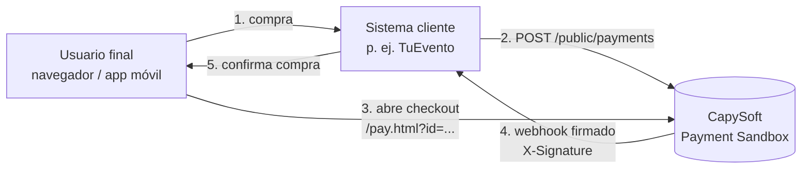
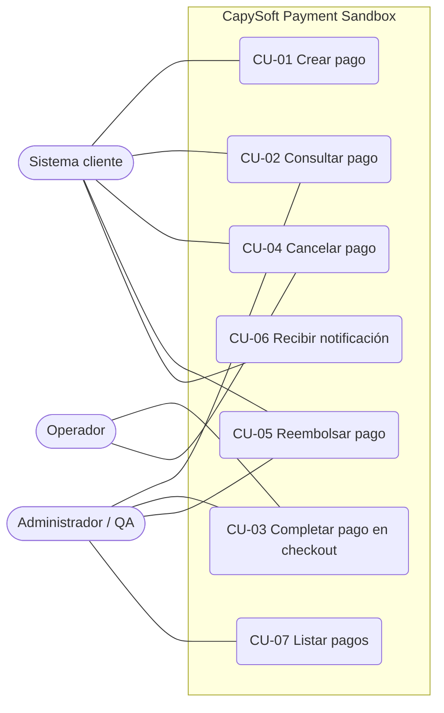

# 01 — Especificación de Requisitos de Software (SRS)

**Producto:** CapySoft Payment Sandbox (CPS) · **Versión del producto:** 1.0.0
**Versión del documento:** 1.1 · **Fecha:** 2026-10-24 · **Elaborado por:** CapySoft
**Estructura de referencia:** ISO/IEC/IEEE 29148:2018 (sucesor de IEEE 830)

---

## 1. Introducción

### 1.1 Propósito

Este documento especifica los requisitos de software de CapySoft Payment Sandbox, una pasarela de pagos de prueba independiente. Está dirigido a los equipos de producto, desarrollo, QA y operaciones de CapySoft y a los equipos que integran sistemas cliente con CPS.

### 1.2 Alcance del producto

CPS permite a un sistema cliente registrar intenciones de pago, presentar al usuario un checkout hospedado, decidir el desenlace de cada transacción y recibir notificaciones firmadas de cada cambio de estado. No mueve dinero real. El alcance detallado y lo que queda fuera están en [00 — Visión y alcance](00-vision-y-alcance.md#6-alcance).

### 1.3 Definiciones, acrónimos y abreviaturas

Ver [11 — Glosario](11-glosario.md). Los más usados aquí:

| Término | Significado |
|---|---|
| Sistema cliente | Aplicación que consume CPS (p. ej. el backend de TuEvento) |
| Pago / transacción | Intención de cobro registrada en CPS, identificada por `paymentId` |
| Referencia externa | Identificador del pago en el sistema cliente (`externalReference`) |
| Webhook | Petición HTTP POST que CPS envía al sistema cliente cuando cambia el estado de un pago |
| Operador | Persona que decide el desenlace de un pago desde el checkout (usuario de prueba, QA, demostrador) |

### 1.4 Referencias

- [02 — Arquitectura](02-arquitectura.md), [03 — Referencia de la API](03-referencia-api.md), [04 — Webhooks](04-webhooks.md), [05 — Modelo de datos](05-modelo-de-datos.md).
- RFC 2104 — HMAC: Keyed-Hashing for Message Authentication.
- ISO 4217 — Códigos de moneda.
- ISO 8601 — Representación de fechas y horas.

### 1.5 Convenciones

- **DEBE** indica obligatoriedad; **DEBERÍA**, recomendación; **PUEDE**, opcionalidad.
- Prioridad: **Alta** (imprescindible para la release), **Media**, **Baja**.
- Estado: **Implementado**, **Parcial** (implementado con limitaciones registradas en [10](10-limitaciones-y-roadmap.md)), **Planificado**.

---

## 2. Descripción general

### 2.1 Perspectiva del producto

CPS es un sistema independiente que se ubica entre el sistema cliente y el usuario final, en el mismo lugar que ocuparía una pasarela comercial.

### 2.2 Funciones del producto (resumen)

1. Registrar pagos y devolver su identificador.
2. Consultar el estado de un pago.
3. Presentar un checkout hospedado que muestra el pago y permite decidir su desenlace.
4. Aplicar una máquina de estados que impide transiciones inválidas.
5. Notificar cada transición al sistema cliente por webhook firmado, con reintentos y auditoría.
6. Listar pagos para administración.

### 2.3 Clases de usuarios

| Clase | Descripción | Interacción |
|---|---|---|
| Sistema cliente | Backend que integra CPS | API REST + recepción de webhooks |
| Operador | Persona que actúa sobre un pago en el checkout | `pay.html` |
| Administrador / QA | Persona o script que fuerza transiciones o revisa pagos | API `/admin/payments` |
| Operaciones | Despliega y monitorea CPS | Contenedor, variables de entorno, logs |

### 2.4 Entorno operativo

- JVM 21 (imagen `eclipse-temurin:21-jre-alpine`).
- PostgreSQL 17 (imagen `postgres:17-alpine`) con base de datos dedicada.
- Cualquier navegador moderno o WebView (Android/iOS) para el checkout.
- Red: el sistema cliente debe alcanzar CPS (puerto 4001 por defecto) y CPS debe alcanzar la URL de webhook del cliente.

### 2.5 Restricciones de diseño e implementación

- Java 21, Spring Boot 3.5, Spring Data JPA, Bean Validation.
- Arquitectura hexagonal (puertos y adaptadores) con dominio libre de dependencias de framework.
- Configuración exclusivamente por variables de entorno (12-factor).
- Fechas en UTC, serializadas como ISO 8601.

### 2.6 Supuestos y dependencias

- El secreto de webhook se comparte fuera de banda entre CPS y el sistema cliente.
- La URL de webhook es única por despliegue.
- El sistema cliente procesa los webhooks de forma idempotente usando `eventId`.

---

## 3. Requisitos específicos

### 3.1 Requisitos de interfaces externas

#### 3.1.1 Interfaz de usuario

| ID | Requisito | Prioridad | Estado |
|---|---|---|---|
| IU-01 | El checkout DEBE ser accesible en `GET /pay.html?id={paymentId}` sin autenticación. | Alta | Implementado |
| IU-02 | El checkout DEBE mostrar estado, monto con formato de moneda, método, referencia externa y fechas de creación y actualización. | Alta | Implementado |
| IU-03 | El checkout DEBE ofrecer las acciones Aprobar, Rechazar, Fallar y Cancelar mientras el pago esté en `PENDING`, usando los endpoints públicos `/public/checkout/{id}/{acción}`. El checkout NO DEBE ofrecer el reembolso, que es una operación del comercio. | Alta | Implementado |
| IU-04 | El checkout DEBE refrescar el estado cada 3 s mientras el pago no sea terminal. | Media | Implementado |
| IU-05 | Si el checkout fue abierto como popup, DEBE notificar a la ventana que lo abrió mediante `postMessage({type:'GATEWAY_ACTION', action})` y cerrarse 1,5 s después de una acción terminal. | Media | Implementado |
| IU-06 | El checkout DEBE resolver la URL de la API con el mismo origen desde el que se sirvió, para funcionar cuando se abre por IP de red local desde un teléfono. | Media | Implementado |
| IU-07 | Si falta el parámetro `id` o el pago no existe, el checkout DEBE mostrar un mensaje de error comprensible. | Media | Implementado |

#### 3.1.2 Interfaces de software

| ID | Requisito | Prioridad | Estado |
|---|---|---|---|
| IS-01 | CPS DEBE exponer una API REST JSON documentada en [03](03-referencia-api.md). | Alta | Implementado |
| IS-02 | CPS DEBE enviar webhooks HTTP POST JSON a la URL configurada en `PAYMENT_CALLBACK_URL`, según [04](04-webhooks.md). | Alta | Implementado |
| IS-03 | CPS DEBE persistir sus datos en una base PostgreSQL propia, no compartida con el sistema cliente. | Alta | Implementado |

#### 3.1.3 Interfaces de comunicación

| ID | Requisito | Prioridad | Estado |
|---|---|---|---|
| IC-01 | Toda comunicación DEBE realizarse sobre HTTP/1.1 con cuerpos `application/json` (UTF-8). En entornos expuestos DEBE ir sobre TLS terminado en el balanceador o ingress. | Alta | Implementado (TLS depende del despliegue) |
| IC-02 | CPS DEBE permitir CORS desde cualquier origen para que el checkout y clientes web de prueba puedan consumirlo. | Media | Implementado |
| IC-03 | Las peticiones a `/admin/**` DEBEN incluir la cabecera `X-Api-Key`; las preflight `OPTIONS` quedan exentas. | Alta | Implementado |

### 3.2 Requisitos funcionales

#### RF-01 Crear pago

| Campo | Descripción |
|---|---|
| Descripción | El sistema cliente registra una intención de pago. |
| Entrada | `externalReference` (texto, obligatorio, ≤ 100), `amount` (decimal > 0, obligatorio), `currency` (código ISO 4217 de 3 letras, obligatorio), `paymentMethod` (`QR` \| `CARD` \| `PSE`, obligatorio). |
| Proceso | Se valida la entrada, se normaliza la moneda a mayúsculas, se genera `paymentId` con formato `fake_<UUID v4>`, se fija el estado `PENDING`, se registran `createdAt`/`updatedAt` y un `webhookEventId` inicial, y se persiste. |
| Salida | HTTP 201 con el pago creado; HTTP 400 con detalle por campo si la entrada es inválida. |
| Notificación | No se emite webhook en la creación (el estado inicial lo conoce el cliente por la respuesta). |
| Prioridad / Estado | Alta / Implementado |

#### RF-02 Consultar pago

| Campo | Descripción |
|---|---|
| Descripción | Cualquier cliente obtiene el estado actual de un pago por `paymentId`. |
| Salida | HTTP 200 con el pago; HTTP 404 si no existe. |
| Prioridad / Estado | Alta / Implementado |

#### RF-03 Aprobar pago

| Campo | Descripción |
|---|---|
| Precondición | Pago en `PENDING`. |
| Proceso | Transición `PENDING → PROCESSING` (persistir + webhook `payment.processing`) y luego `PROCESSING → APPROVED` (persistir + webhook `payment.approved`). |
| Salida | HTTP 200 sin cuerpo; HTTP 400 si la transición no es válida; HTTP 404 si no existe. |
| Prioridad / Estado | Alta / Implementado |

#### RF-04 Rechazar pago

Igual que RF-03 con desenlace `DECLINED` y webhook `payment.declined`. Representa un rechazo del emisor (fondos insuficientes, tarjeta bloqueada). **Alta / Implementado.**

#### RF-05 Fallar pago

Igual que RF-03 con desenlace `FAILED` y webhook `payment.failed`. Representa un error técnico de la red de pagos. **Alta / Implementado.**

#### RF-06 Cancelar pago

| Campo | Descripción |
|---|---|
| Precondición | Pago en `PENDING`. |
| Proceso | Transición directa `PENDING → CANCELLED`, persistir, webhook `payment.cancelled`. |
| Uso | El usuario abandona el checkout, o el sistema cliente cancela un pago que expiró en su lado. |
| Prioridad / Estado | Alta / Implementado |

#### RF-07 Reembolsar pago

| Campo | Descripción |
|---|---|
| Precondición | Pago en `APPROVED`. |
| Proceso | Transición `APPROVED → REFUNDED`, persistir, webhook `payment.refunded`. Reembolso total. |
| Salida | HTTP 200; HTTP 400 desde cualquier otro estado. |
| Prioridad / Estado | Alta / Implementado |

#### RF-08 Máquina de estados

CPS DEBE rechazar con `InvalidStatusTransitionException` (HTTP 400) cualquier transición no listada:

| Desde | Hacia permitidos |
|---|---|
| `PENDING` | `PROCESSING`, `CANCELLED` |
| `PROCESSING` | `APPROVED`, `DECLINED`, `FAILED` |
| `APPROVED` | `REFUNDED` |
| `DECLINED`, `FAILED`, `CANCELLED`, `REFUNDED` | — (terminales) |

**Alta / Implementado.** Diagrama en [05](05-modelo-de-datos.md#3-máquina-de-estados).

#### RF-09 Notificación por webhook

| Campo | Descripción |
|---|---|
| Descripción | Por cada transición de estado, CPS envía un webhook al sistema cliente. |
| Contenido | `eventId` (UUID único por transición), `event` (`payment.<estado>`), `paymentId`, `status`, `amount`, `currency`, `timestamp`. |
| Firma | Cabecera `X-Signature` = HMAC-SHA256 hexadecimal en minúsculas del cuerpo exacto, con `WEBHOOK_SECRET`. |
| Éxito | Respuesta HTTP 2xx del cliente. |
| Prioridad / Estado | Alta / Implementado |

#### RF-10 Reintentos de webhook

CPS DEBE realizar hasta 3 intentos de entrega por evento cuando el cliente no responde 2xx o hay error de red, con espera entre intentos (2 s y 10 s, configurable). El primer intento DEBE ser síncrono; los reintentos NO DEBEN bloquear la petición que originó la transición. Cada intento DEBE tener *timeouts* de conexión y lectura. **Alta / Implementado.**

#### RF-11 Auditoría de entregas

CPS DEBE registrar cada intento de entrega con `eventId`, número de intento, código HTTP recibido (si hubo), mensaje de error (si hubo) y fecha de envío. **Media / Implementado.**

#### RF-12 Listar pagos

`GET /admin/payments` DEBE devolver todos los pagos registrados. **Media / Implementado** (sin paginación, ver L-06).

#### RF-13 Control de acceso administrativo

| Campo | Descripción |
|---|---|
| Descripción | Las operaciones de `/admin/**` (listar, consultar, forzar desenlaces, cancelar, reembolsar) DEBEN exigir una API key en la cabecera `X-Api-Key`. |
| Proceso | Comparación en tiempo constante con `ADMIN_API_KEY`. Sin cabecera o con clave incorrecta: HTTP 401 sin ejecutar la operación. |
| Arranque | La clave NO DEBE tener valor por defecto. CPS NO DEBE arrancar si falta, está vacía o tiene menos de 16 caracteres, y DEBERÍA advertir en el log si usa la clave de desarrollo. |
| Prioridad / Estado | Alta / Implementado |

#### RF-14 Errores de cliente

CPS DEBE responder 4xx con un mensaje accionable ante errores del cliente (validación → 400 con detalle por campo, JSON mal formado o enum inválido → 400, tipo de contenido → 415, método → 405, ruta → 404) y 500 con un mensaje genérico ante errores internos, sin exponer detalles de implementación. **Alta / Implementado.**

### 3.3 Casos de uso

#### CU-01 Crear pago

- **Actor:** Sistema cliente. **Requisitos:** RF-01.
- **Flujo principal:** 1) El cliente envía `POST /public/payments`. 2) CPS valida y persiste. 3) CPS responde 201 con `paymentId`. 4) El cliente guarda `paymentId` asociado a su orden y construye la URL de checkout.
- **Flujo alterno:** 2a) Entrada inválida → CPS responde con error y no persiste nada.

#### CU-03 Completar pago en checkout

- **Actor:** Operador. **Requisitos:** IU-01…IU-05, RF-03…RF-05, RF-09.
- **Precondición:** Pago en `PENDING`.
- **Flujo principal:** 1) El cliente abre `/pay.html?id={paymentId}` (popup web o WebView móvil). 2) CPS muestra el pago. 3) El operador elige Aprobar, Rechazar o Fallar. 4) CPS aplica las transiciones y envía los webhooks `payment.processing` y `payment.<desenlace>`. 5) El checkout muestra el estado final, avisa a la ventana padre y se cierra.
- **Flujo alterno:** 3a) El operador elige Cancelar → `payment.cancelled`. 4a) El pago ya no está en `PENDING` (otra pestaña actuó antes) → CPS responde 400 y el checkout muestra el error.

#### CU-05 Reembolsar pago

- **Actores:** Sistema cliente (p. ej. un organizador cancela un evento) o Administrador / QA. **Requisitos:** RF-07, RF-09, RF-13.
- **Flujo principal:** 1) `POST /admin/payments/{id}/refund` con `X-Api-Key`. 2) CPS valida la clave y que el estado sea `APPROVED`. 3) Transición a `REFUNDED` y webhook `payment.refunded`.
- **Flujo alterno:** 2a) Estado distinto de `APPROVED` → 400.

#### CU-06 Recibir notificación

- **Actor:** Sistema cliente. **Requisitos:** RF-09…RF-11.
- **Flujo principal:** 1) CPS envía POST firmado. 2) El cliente recalcula la firma y la compara. 3) El cliente verifica que `eventId` no haya sido procesado. 4) El cliente actualiza su orden y responde 2xx.
- **Flujo alterno:** 2a) Firma inválida → el cliente responde 4xx y descarta. 4a) El cliente responde no-2xx o no responde → CPS reintenta.

### 3.4 Requisitos no funcionales

| ID | Categoría | Requisito | Estado |
|---|---|---|---|
| RNF-01 | Rendimiento | Crear o consultar un pago DEBERÍA responder en < 300 ms (p95) con la base de datos en la misma red. | Implementado (no medido formalmente) |
| RNF-02 | Rendimiento | Una transición DEBERÍA responder en < 1 s cuando el webhook se entrega al primer intento, y no DEBE esperar a los reintentos cuando falla. | Implementado |
| RNF-03 | Disponibilidad | CPS DEBE arrancar sin intervención manual si la base de datos está disponible; el esquema se crea/actualiza solo. | Implementado |
| RNF-04 | Fiabilidad | Un pago NUNCA DEBE quedar en un estado no permitido por la máquina de estados (restricción en dominio + `CHECK` en base de datos). | Implementado |
| RNF-05 | Fiabilidad | Cada transición DEBE tener un `eventId` único (restricción `UNIQUE` en BD) que permita la idempotencia en el cliente. | Implementado |
| RNF-06 | Seguridad | Los webhooks DEBEN ir firmados con HMAC-SHA256; el secreto DEBE configurarse por entorno y nunca versionarse. | Implementado |
| RNF-07 | Seguridad | CPS NO DEBE recibir, procesar ni almacenar datos de tarjeta ni datos personales del pagador. | Implementado |
| RNF-08 | Seguridad | Los endpoints `/admin/**` DEBEN exigir autenticación (RF-13). | Implementado |
| RNF-09 | Portabilidad | CPS DEBE ejecutarse como contenedor OCI sin dependencias del host salvo PostgreSQL. | Implementado |
| RNF-10 | Mantenibilidad | El dominio NO DEBE depender de Spring ni JPA; la infraestructura se conecta por puertos. | Implementado |
| RNF-11 | Observabilidad | Cada intento de webhook DEBE registrarse en log de aplicación y en la tabla de auditoría. | Implementado |
| RNF-12 | Usabilidad | El checkout DEBE ser usable en pantallas móviles desde 360 px de ancho. | Implementado |
| RNF-13 | Interoperabilidad | El contrato NO DEBE contener conceptos propios de un sistema cliente particular. | Implementado |
| RNF-14 | Configurabilidad | Puerto, base de datos, URL de webhook, secreto, API key, *timeouts*, *backoff* y nivel de log DEBEN ser configurables por variables de entorno. | Implementado |
| RNF-15 | Verificabilidad | Las reglas de dominio, los casos de uso, la firma, los reintentos, el control de acceso y el contrato HTTP DEBEN tener pruebas automatizadas ejecutables sin base de datos. | Implementado (53 pruebas) |

### 3.5 Requisitos de base de datos lógica

Ver [05 — Modelo de datos](05-modelo-de-datos.md). Resumen: tabla `payments` (un registro por pago, estado actual) y tabla `webhook_delivery_logs` (un registro por intento de entrega).

---

## 4. Matriz de trazabilidad

| Requisito | Componente principal | Endpoint / artefacto | Caso de prueba ([08](08-plan-de-pruebas.md)) |
|---|---|---|---|
| RF-01 | `CreatePaymentUseCase`, `Payment.create` | `POST /public/payments` | CP-01, CP-02, CP-03 |
| RF-02 | `GetPaymentUseCase` | `GET /public/payments/{id}`, `GET /admin/payments/{id}` | CP-04, CP-05 |
| RF-03 | `ApprovePaymentUseCase` | `POST /public/checkout/{id}/approve`, `POST /admin/payments/{id}/approve` | CP-06 |
| RF-04 | `DeclinePaymentUseCase` | `POST /public/checkout/{id}/decline`, `POST /admin/payments/{id}/decline` | CP-07 |
| RF-05 | `FailPaymentUseCase` | `POST /public/checkout/{id}/fail`, `POST /admin/payments/{id}/fail` | CP-08 |
| RF-06 | `CancelPaymentUseCase` | `POST /public/checkout/{id}/cancel`, `POST /admin/payments/{id}/cancel` | CP-09 |
| RF-07 | `RefundPaymentUseCase` | `POST /admin/payments/{id}/refund` | CP-10, CP-11 |
| RF-08 | `PaymentStatus`, `Payment.transitionTo` | — | CP-12 |
| RF-09 | `WebhookNotifierAdapter`, `WebhookDeliveryClient` | Webhook saliente | CP-13, CP-14 |
| RF-10 | `WebhookRetryScheduler` | Webhook saliente | CP-15 |
| RF-11 | `WebhookDeliveryLogEntity` | Tabla `webhook_delivery_logs` | CP-16 |
| RF-12 | `AdminPaymentController.listPayments` | `GET /admin/payments` | CP-17 |
| RF-13 | `AdminApiKeyInterceptor` | `/admin/**` | CP-24, CP-25 |
| RF-14 | `GlobalExceptionHandler` | Todas | CP-02, CP-03, CP-26 |
| IU-01…07 | `pay.html` | `GET /pay.html` | CP-18…CP-21 |

## 5. Apéndice — Control de cambios

| Versión | Fecha | Cambios |
|---|---|---|
| 1.0 | 2026-10-24 | Versión inicial alineada con la release 1.0.0 |
| 1.1 | 2026-10-24 | RF-10 completo (reintentos asíncronos), RF-13 (API key en `/admin`), RF-14 (errores 4xx), checkout sobre `/public/checkout`, RNF-15 (pruebas automatizadas) |
