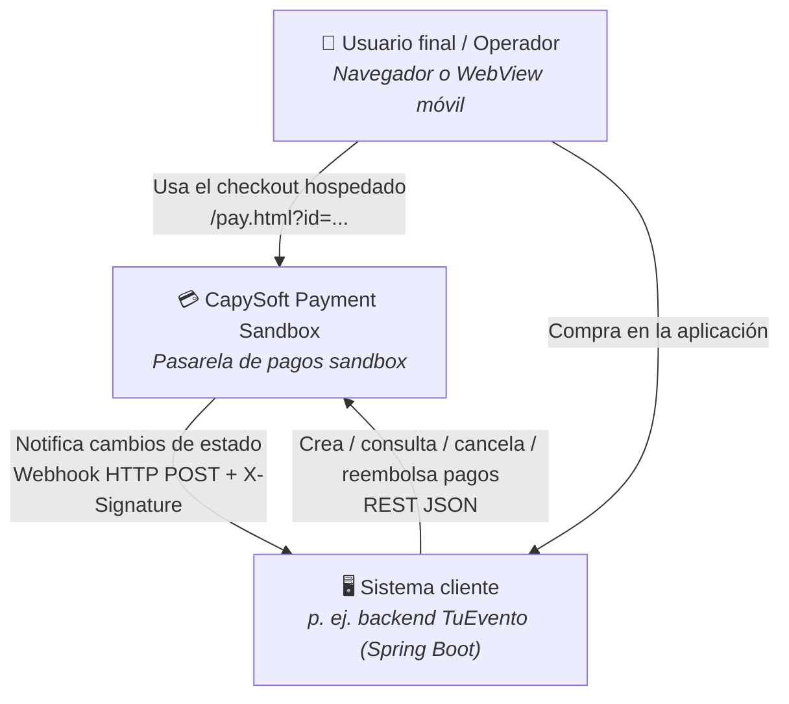
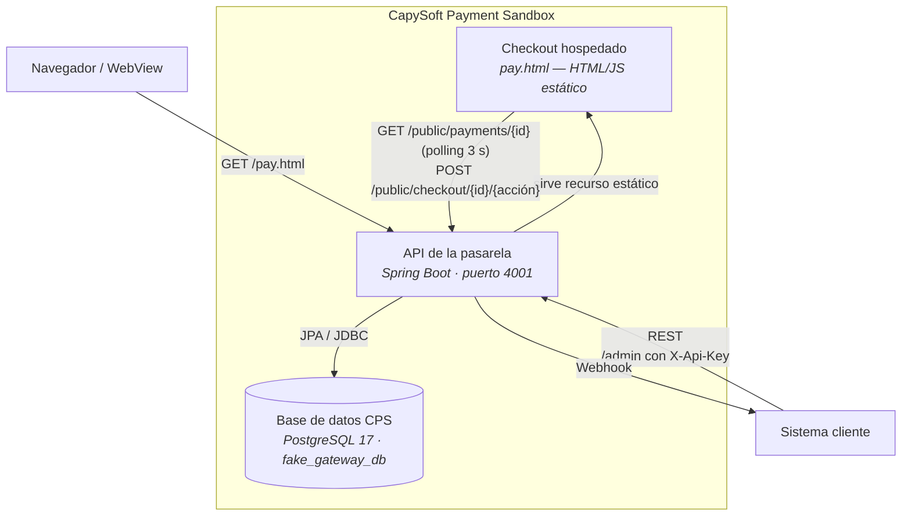
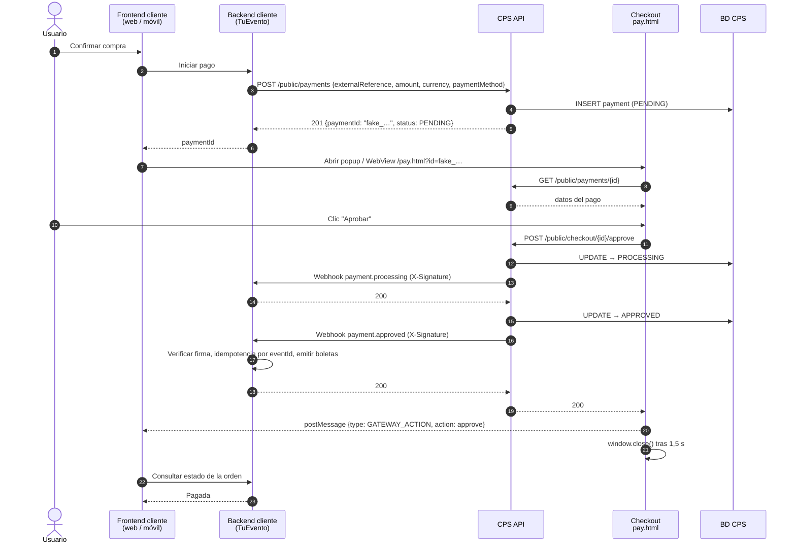
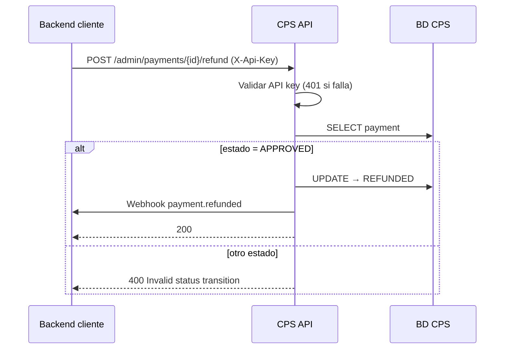
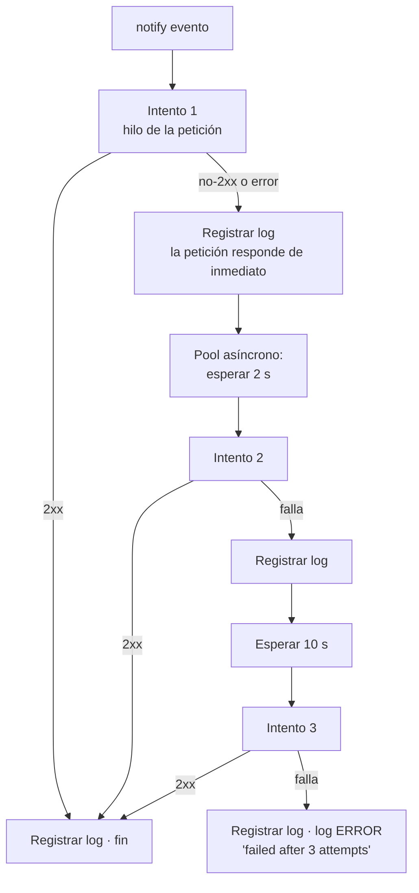
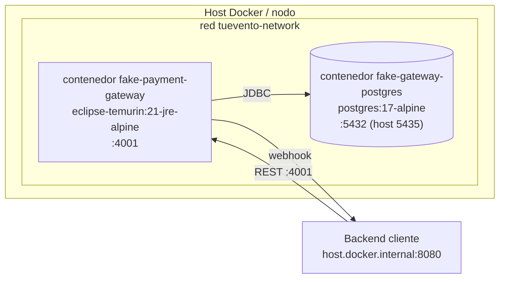

# 02 — Documento de arquitectura de software (SAD)

**Producto:** CapySoft Payment Sandbox (CPS) 1.0.0 · **Versión del documento:** 1.1 · **Fecha:** 2026-10-24

---

## 1. Objetivos y restricciones arquitectónicas

| Objetivo | Cómo se logra |
|---|---|
| Comportarse como una pasarela real desde el punto de vista del cliente | Contrato HTTP + webhooks firmados; ningún acoplamiento de código con el cliente |
| Reglas de negocio protegidas | Máquina de estados en el dominio, reforzada con `CHECK` en base de datos |
| Dominio independiente del framework | Arquitectura hexagonal: el paquete `domain` no importa Spring ni JPA |
| Despliegue trivial | Un solo JAR, un contenedor, configuración por variables de entorno |
| Facilidad de evolución | Puertos de salida (`PaymentRepository`, `WebhookNotifierPort`) intercambiables |

**Stack:** Java 21 · Spring Boot 3.5 (Web, Data JPA, Validation) · PostgreSQL 17 · Jackson · Lombok · HTML/CSS/JS sin dependencias para el checkout.

## 2. Vista de contexto (C4 nivel 1)



## 3. Vista de contenedores (C4 nivel 2)



La base de datos es **exclusiva** de CPS: en `docker-compose.yml` corre como el servicio `postgres-fake-gateway` (puerto host 5435), separado del Postgres de TuEvento. Ver [ADR-001](adr/ADR-001-servicio-y-base-de-datos-independientes.md).

## 4. Vista de componentes (C4 nivel 3) — arquitectura hexagonal

```mermaid
flowchart LR
    subgraph interfaces [interfaces.rest — adaptadores de entrada]
        KEY{{AdminApiKeyInterceptor<br/>X-Api-Key}}
        PPC[PublicPaymentController<br/>/public/payments]
        CKC[CheckoutController<br/>/public/checkout]
        APC[AdminPaymentController<br/>/admin/payments]
        GEH[GlobalExceptionHandler]
    end
    subgraph application [application — casos de uso]
        UC1[CreatePaymentUseCase]
        UC2[GetPaymentUseCase]
        UC3[Approve / Decline / Fail<br/>PaymentUseCase]
        UC4[CancelPaymentUseCase]
        UC5[RefundPaymentUseCase]
        PORT[[WebhookNotifierPort]]
    end
    subgraph domain [domain — núcleo]
        PAY[Payment<br/>aggregate root]
        ST[PaymentStatus<br/>máquina de estados]
        MON[Money<br/>value object]
        EV[PaymentStatusChanged<br/>evento de dominio]
        REPO[[PaymentRepository]]
    end
    subgraph infrastructure [infrastructure — adaptadores de salida]
        PRA[PaymentRepositoryAdapter<br/>+ PaymentJpaRepository]
        WNA[WebhookNotifierAdapter]
        WDC[WebhookDeliveryClient<br/>HMAC + HTTP + bitácora]
        WRS[WebhookRetryScheduler<br/>@Async]
        WDL[WebhookDeliveryLogRepository]
    end

    PPC --> UC1 & UC2
    CKC --> UC3 & UC4
    KEY --> APC
    APC --> UC2 & UC3 & UC4 & UC5
    UC1 & UC2 & UC3 & UC4 & UC5 --> PAY
    UC1 & UC2 & UC3 & UC4 & UC5 --> REPO
    UC3 & UC4 & UC5 --> PORT
    PAY --> ST & MON & EV
    PRA -. implementa .-> REPO
    WNA -. implementa .-> PORT
    WNA -- intento 1 --> WDC
    WNA -- si falla --> WRS
    WRS -- intentos 2..n --> WDC
    WDC --> WDL
```

### 4.1 Responsabilidades por capa

| Capa | Paquete | Responsabilidad | Depende de |
|---|---|---|---|
| Dominio | `domain.model`, `domain.event`, `domain.repository` | Reglas de negocio: creación del pago, transiciones válidas, valor monetario, evento de cambio de estado. Interfaz pura del repositorio. | Nada (solo JDK) |
| Aplicación | `application.usecase`, `application.dto`, `application.port.out` | Orquesta un caso de uso por clase: carga el agregado, invoca el dominio, persiste, notifica. Define el puerto de notificación. | Dominio |
| Infraestructura | `infrastructure.persistence`, `infrastructure.webhook`, `infrastructure.security` | JPA, firma HMAC, HTTP saliente, reintentos asíncronos, auditoría, API key de `/admin`. | Aplicación, dominio, Spring |
| Interfaces | `interfaces.rest` | Controladores REST, mapeo de excepciones a HTTP. | Aplicación |
| Configuración | `config.WebConfig` | CORS, recursos estáticos, `RestTemplate` con *timeouts*, `@EnableAsync`. | Spring |

### 4.2 Inventario de componentes

| Componente | Archivo | Descripción |
|---|---|---|
| `Payment` | `domain/model/Payment.java` | Agregado. `create()` genera `fake_<UUID>`, estado `PENDING` y un `webhookEventId`. Cada método de transición (`markAsProcessing`, `approve`, `decline`, `fail`, `cancel`, `refund`) valida, cambia estado, renueva `updatedAt` y `webhookEventId`, y devuelve un `PaymentStatusChanged`. |
| `PaymentStatus` | `domain/model/PaymentStatus.java` | Enum con `allowedTransitions()` por estado, `canTransitionTo()` e `isTerminal()`. |
| `Money` | `domain/model/Money.java` | Value object inmutable; rechaza montos negativos y monedas vacías; normaliza la moneda a mayúsculas. |
| `PaymentMethod` | `domain/model/PaymentMethod.java` | `QR`, `CARD`, `PSE`. |
| `PaymentStatusChanged` | `domain/event/PaymentStatusChanged.java` | Evento inmutable: `eventId`, `paymentId`, `status`, `money`, `timestamp`. |
| `PaymentRepository` | `domain/repository/PaymentRepository.java` | `save`, `findByPaymentId`, `existsByPaymentId`, `findAll`. |
| `WebhookNotifierPort` | `application/port/out/WebhookNotifierPort.java` | `notify(PaymentStatusChanged)`. |
| Casos de uso | `application/usecase/*.java` | Uno por operación; todos `@Transactional`. |
| `PaymentRepositoryAdapter` | `infrastructure/persistence/` | Traduce entre `Payment` y `PaymentEntity`. |
| `WebhookNotifierAdapter` | `infrastructure/webhook/` | Implementa el puerto: primer intento síncrono y, si falla, delega los reintentos. |
| `WebhookDeliveryClient` | `infrastructure/webhook/` | Un intento de entrega: serializa `WebhookPayload`, firma, envía con `RestTemplate` (3 s / 5 s de *timeout*) y registra en la bitácora. Nunca lanza excepciones. |
| `WebhookRetryScheduler` | `infrastructure/webhook/` | Bean separado con método público `@Async`: reintentos con *backoff* configurable en el pool asíncrono, sin bloquear la petición. |
| `AdminApiKeyInterceptor` | `infrastructure/security/` | Interceptor de Spring MVC registrado en `/admin/**` que exige `X-Api-Key` (tiempo constante); se evalúa sobre la ruta normalizada que usa el enrutamiento, por lo que no se evade con `/%61dmin` ni `;matrix`. Deja pasar las preflight CORS. |
| `CheckoutController` | `interfaces/rest/public_api/` | Acciones del pagador: aprobar, rechazar, fallar, cancelar. Sin reembolso. |
| `GlobalExceptionHandler` | `interfaces/rest/` | 400 validación (con detalle por campo) / JSON inválido / transición inválida, 404, 405, 409, 415 y 500 con mensaje genérico. |
| `pay.html` | `src/main/resources/static/` | Checkout hospedado. |

## 5. Vista dinámica

### 5.1 Flujo completo de compra (caso TuEvento)



### 5.2 Reembolso iniciado por el sistema cliente



### 5.3 Entrega de webhook con reintentos



Detalles y limitaciones actuales en [04 — Webhooks](04-webhooks.md#6-respuesta-esperada-y-reintentos).

## 6. Vista de despliegue



Procedimiento completo en [07 — Despliegue y operación](07-despliegue-y-operacion.md).

## 7. Decisiones de arquitectura

| ADR | Decisión |
|---|---|
| [ADR-001](adr/ADR-001-servicio-y-base-de-datos-independientes.md) | Servicio y base de datos independientes del sistema cliente |
| [ADR-002](adr/ADR-002-maquina-de-estados-en-el-dominio.md) | Máquina de estados encapsulada en el dominio |
| [ADR-003](adr/ADR-003-webhooks-firmados-hmac.md) | Webhooks firmados con HMAC-SHA256 |
| [ADR-004](adr/ADR-004-checkout-hospedado.md) | Checkout hospedado servido por la propia pasarela |
| [ADR-005](adr/ADR-005-arquitectura-hexagonal.md) | Arquitectura hexagonal con puertos de salida |
| [ADR-006](adr/ADR-006-api-key-admin-y-checkout-publico.md) | API key en `/admin` y endpoints públicos dedicados para el checkout |

## 8. Atributos de calidad

| Atributo | Táctica |
|---|---|
| Integridad | Validación en tres niveles: Bean Validation en el DTO, invariantes en `Money`/`Payment`, `CHECK` y `UNIQUE` en la base de datos |
| Seguridad de mensajes | HMAC-SHA256 sobre el cuerpo exacto |
| Control de acceso | API key en `/admin/**`; checkout autorizado por posesión del `paymentId` |
| Disponibilidad | Reintentos fuera del hilo de la petición; *timeouts* en el HTTP saliente |
| Verificabilidad | 52 pruebas automatizadas sin dependencia de base de datos |
| Idempotencia | `eventId` nuevo y único por transición |
| Trazabilidad | Bitácora de entregas + logs estructurados con `eventId` y número de intento |
| Modificabilidad | Puertos y adaptadores; un caso de uso por clase |
| Portabilidad | Imagen Docker multi-etapa; 12-factor |
