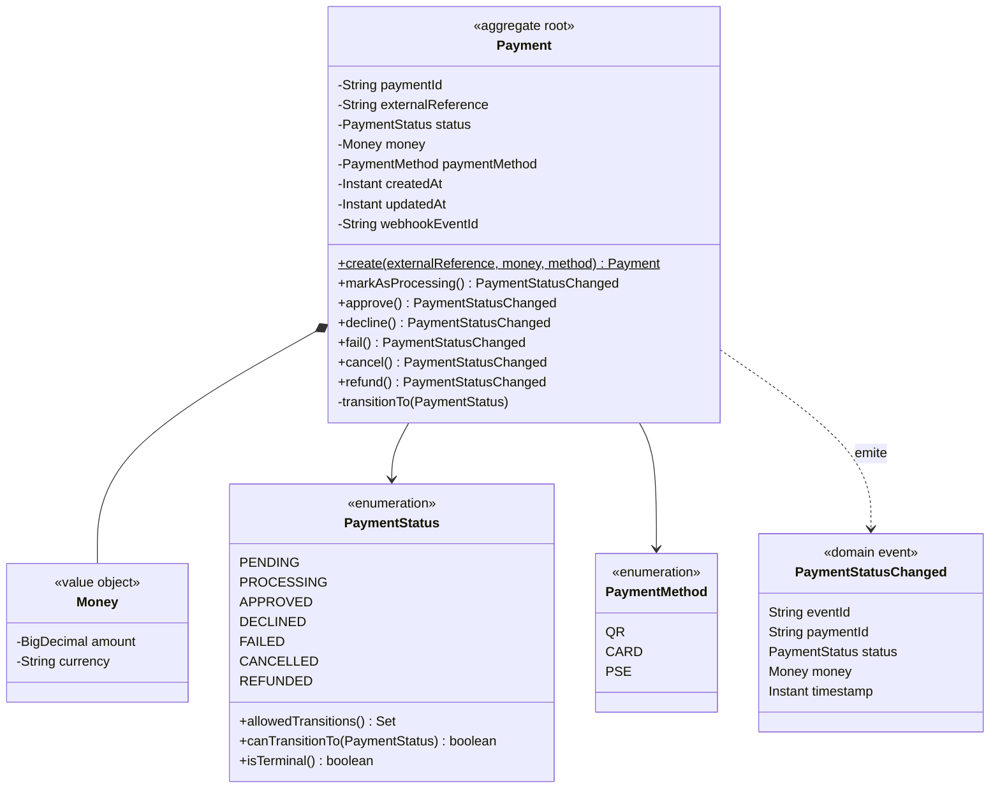
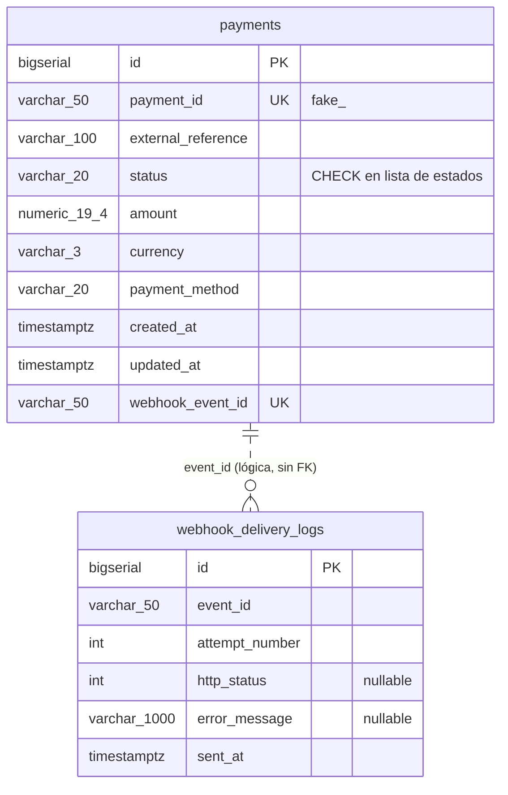
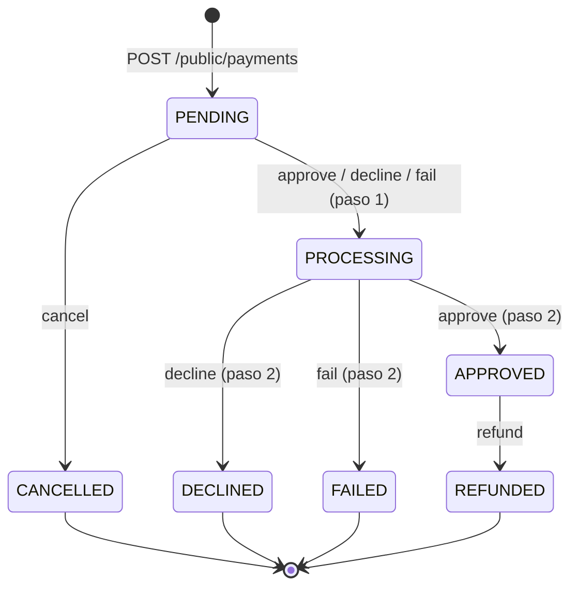

# 05 — Modelo de datos

**Producto:** CapySoft Payment Sandbox (CPS) 1.0.0 · **Versión del documento:** 1.0 · **Fecha:** 2026-10-24

---

## 1. Modelo de dominio



### 1.1 Invariantes

| Invariante | Dónde se garantiza |
|---|---|
| Todo pago nace en `PENDING` | `Payment.create` |
| Solo se permiten las transiciones de la sección 3 | `Payment.transitionTo` + `PaymentStatus.canTransitionTo` |
| Cada transición tiene un `eventId` nuevo y único | `transitionTo` regenera `webhookEventId`; `UNIQUE` en BD |
| El monto no es negativo y la moneda no es vacía | Constructor de `Money` (el DTO exige además monto > 0) |
| La moneda se almacena en mayúsculas | Constructor de `Money` |
| `paymentId` es único y con prefijo `fake_` | `Payment.create`; `UNIQUE` en BD |

## 2. Esquema relacional

El esquema lo genera Hibernate a partir de las entidades (`spring.jpa.hibernate.ddl-auto=update`).



### 2.1 Tabla `payments`

| Columna | Tipo | Nulo | Restricciones | Descripción |
|---|---|---|---|---|
| `id` | `bigint` identity | No | PK | Clave técnica |
| `payment_id` | `varchar(50)` | No | UNIQUE | Identificador público |
| `external_reference` | `varchar(100)` | No | — | Referencia del sistema cliente |
| `status` | `varchar(20)` | No | CHECK `IN ('PENDING','PROCESSING','APPROVED','DECLINED','FAILED','CANCELLED','REFUNDED')` | Estado actual |
| `amount` | `numeric(19,4)` | No | — | Monto |
| `currency` | `varchar(3)` | No | — | ISO 4217 |
| `payment_method` | `varchar(20)` | No | — | `QR`, `CARD`, `PSE` |
| `created_at` | `timestamp(6) with time zone` | No | — | Creación |
| `updated_at` | `timestamp(6) with time zone` | No | — | Última transición |
| `webhook_event_id` | `varchar(50)` | No | UNIQUE | `eventId` de la última transición |

### 2.2 Tabla `webhook_delivery_logs`

| Columna | Tipo | Nulo | Descripción |
|---|---|---|---|
| `id` | `bigint` identity | No | Clave técnica |
| `event_id` | `varchar(50)` | No | `eventId` del webhook |
| `attempt_number` | `integer` | No | 1, 2 o 3 |
| `http_status` | `integer` | Sí | Código devuelto por el cliente; nulo si hubo error de red |
| `error_message` | `varchar(1000)` | Sí | Mensaje de la excepción, si la hubo |
| `sent_at` | `timestamp(6) with time zone` | No | Momento del intento |

> La relación con `payments` es lógica: `payments.webhook_event_id` solo guarda el **último** `eventId`, así que los eventos anteriores de un pago no son trazables desde la tabla de pagos. Agregar `payment_id` a la bitácora está en la hoja de ruta (L-07).

## 3. Máquina de estados



| Estado | Significado | Terminal | Acciones posibles |
|---|---|---|---|
| `PENDING` | Pago creado, esperando que el usuario lo complete | No | approve, decline, fail, cancel |
| `PROCESSING` | Autorización en curso | No | (interno; en 1.0.0 dura lo que tarda la petición) |
| `APPROVED` | Cobro aprobado | No* | refund |
| `DECLINED` | Rechazado por el emisor | Sí | — |
| `FAILED` | Error técnico | Sí | — |
| `CANCELLED` | Cancelado antes de procesarse | Sí | — |
| `REFUNDED` | Reembolsado totalmente | Sí | — |

\* `APPROVED` no es terminal para el dominio porque admite reembolso; el checkout lo trata como terminal para el flujo de compra.

## 4. Gestión del esquema

- 1.0.0 usa `ddl-auto: update`: Hibernate crea tablas y columnas nuevas al arrancar, pero no elimina ni renombra.
- La restricción `CHECK` de `status` se crea con la tabla. Si una base existente se creó antes de la llegada de `REFUNDED`, el `CHECK` antiguo debe recrearse manualmente:

  ```sql
  ALTER TABLE payments DROP CONSTRAINT IF EXISTS payments_status_check;
  ALTER TABLE payments ADD CONSTRAINT payments_status_check
    CHECK (status IN ('PENDING','PROCESSING','APPROVED','DECLINED','FAILED','CANCELLED','REFUNDED'));
  ```

- La migración a Liquibase/Flyway versionado está planificada (L-05).
